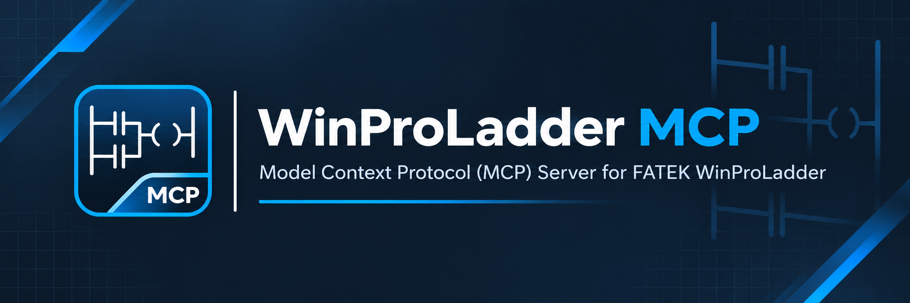

<p align="center">
  
</p>

<div align="center">
  <h1>WinProLadder MCP</h1>
  <p><strong>讓 AI 將控制需求轉成 WinProLadder <code>.ldr</code> 檔案</strong></p>
  <p>也能讀取、分析及安全地修改既有檔案</p>
  <p>
    <a href="https://github.com/Syrup2718/winproladder-mcp/releases/latest"></a>
    <a href="LICENSE"></a>
    <a href="https://www.python.org/"></a>
    <a href="https://github.com/Syrup2718/winproladder-mcp/stargazers">
    
    </a>
    <a href="https://github.com/Syrup2718/winproladder-mcp">
    
    </a>
  </p>
  <p><strong>繁體中文</strong> · <a href="docs/project/README.en.md">English</a></p>
</div>

<p align="center">
  <a href="docs/quickstart.md">快速開始</a> ·
  <a href="docs/project/FEATURES.md">功能總覽</a> ·
  <a href="docs/supported-functions.md">FUNC 支援表</a> ·
  <a href="docs/README.md">完整文件</a>
</p>

> [!IMPORTANT]
> 本專案不是 FATEK 官方產品，不會連線或下載程式到 PLC。

## 主要功能

- 產生啟停、自保持、計時、計數、正反轉、星三角與順序控制。
- 支援自訂 Ladder IR，以及多種 FATEK 原生 FUNC 編解碼。
- `generate_common_fun_ldr` 可將參數化 MOV、四則運算、INC/DEC、AND/OR/XOR/XNR、
  CMP/ZNCMP、DIV48/SUM、MEAN/SQRT/NEG/ABS/EXT、ADCNV/MLC、BITRD/BITWR、
  19 種浮點運算、FCMP/FZCP、table/matrix、packing/shift、資料轉換、
  WDT/RSWDT、FUN92 HSC0–3/HSTA 與取樣的 FUN93D HSC0、UDCTR、comparison contacts、
  明確 I/O/profile 的周邊／脈波／TPCTL、
  file/memory-pack、STAT、Timer/Counter 與 PID 組成完整 `.ldr`，
  並沿用 Production codec、CRC 與輸出 bytes 回讀驗證。
- 產檔前檢查 I/O、元件範圍、重複 writer、工作區政策及實際輸出 bytes。
- 提供有限的離線掃描模型與 acceptance cases。
- 讀取、比較、分析及安全地另存 `.ldr`。
- 依使用者要求另產生 CP950／Big5 元件註解 `.txt`。
- 使用本機範本檢查及產生實驗性的 `.pdw` 專案。

完整範圍請看[功能總覽](docs/project/FEATURES.md)與 [FUNC 支援表](docs/supported-functions.md)。

## 版本與執行中能力

### 最新版本

目前版本為 **v1.2.0**。此版本提供 24 個 MCP tools，並新增參數化
`generate_common_fun_ldr`，涵蓋 131 個 Common FUN evidence keys。這些 evidence keys
不代表所有 FUN、operand 或 mode 均已完整驗證；已發布內容與下載請見
[Releases](https://github.com/Syrup2718/winproladder-mcp/releases/latest) 與
[CHANGELOG](docs/project/CHANGELOG.md)。

### Experimental features

[`.pdw` 專案產生器](docs/pdw-format.md)仍屬實驗功能。它使用本機
FBs-20MC／32MC／40MC／60MC 範本，支援共用 Ladder 編譯、可變長度程式、分區、
中文註解與已有模組紀錄的保留／選用，但仍有格式及指令驗證限制。

### 查詢目前 server

呼叫 `get_capabilities` 可查看執行中 server 的 `version`、`build.commit`、
`build.distribution_state` 與 `response_mode`。預設是精簡回應；只有需要完整 schema 與
證據細節時才傳入 `detail=true`，或以 `--full-responses` 啟動。

## 快速安裝

下載原始碼並在專案目錄執行：

### Windows PowerShell

```powershell
powershell -NoProfile -ExecutionPolicy Bypass -File .\install.ps1
```

### macOS / Linux

```sh
sh install.sh
```

安裝完成後，將 `.install/mcp-config.json` 或 `.install/mcp-config.toml` 中的
`winproladder` 設定加入 MCP client，再重新連線。詳細說明見[安裝指南](docs/installation.md)。

## 使用範例

直接用自然語言描述控制需求與 I/O：

> X0 啟動、X1=1 停止、Y0 自保持，停止優先。驗證後產生 motor.ldr。

需要元件註解時一併說明：

> 另外新增元件註解：X0 是啟動按鈕，Y0 是馬達輸出。

MCP 會回傳可下載的 `.ldr`；明確要求註解時，另回傳 `.txt`。預設輸出位於
`artifacts/`，且不覆寫同名檔案。

## 驗證邊界

本專案負責離線產生、解析與驗證檔案。WinProLadder GUI 匯入、PLC 下載及實機測試由使用者在目標環境完成。離線模型通過不等於實體設備已驗證。

目前私有紀錄顯示 131 個 Common evidence keys 各至少一個代表 form 可在 GUI 顯示；這不等於
131 個不同 FUN，也不代表所有參數、GUI 另存再開啟或 PLC 執行均已驗證。

## 文件

| 類別 | 文件 |
| --- | --- |
| 入門 | [5 分鐘快速開始](docs/quickstart.md) · [安裝指南](docs/installation.md) |
| 功能 | [功能總覽](docs/project/FEATURES.md) · [FUNC 支援表](docs/supported-functions.md) |
| 參考 | [使用與參數參考](docs/reference.md) · [完整文件索引](docs/README.md) |
| 驗證與開發 | [專案架構](ARCHITECTURE.md) · [驗證方式與證據等級](docs/verification.md) · [貢獻指南](docs/project/CONTRIBUTING.md) |

版本內容與後續變更統一記錄在 [CHANGELOG](docs/project/CHANGELOG.md)。

## 授權

本專案原創程式碼與文件採用 [MIT License](LICENSE)，Copyright © 2026 syrup2718。
